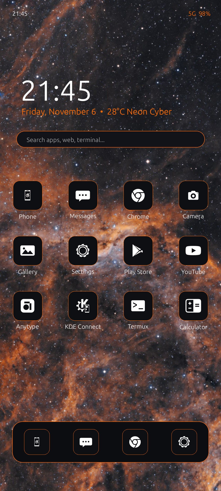

# Space Neon Minimal — Tecno HiOS & Infinix XOS Theme

An ultra-minimal, high-contrast dark theme designed for **Tecno (HiOS)** and **Infinix (XOS)** smartphones, ported directly from the [Space Neon Plasma](../space-neon-plasma) desktop project.

Deep space blacks (`#0A0A0B`), grayscale hierarchy, and vibrant neon orange (`#FF6B00`) accents packaged into official Transsion `.zth` (Zip Theme for HiOS) and `.xth` (XOS) bundles.



---

## Highlights & Features

- **Cyber Deep Space Aesthetic**: Pure `#0A0A0B` obsidian background designed for OLED / AMOLED energy efficiency and eye comfort.
- **Vibrant Neon Orange Accents**: Highlight color (`#FF6B00`) applied to borders, indicators, and primary action glyphs.
- **55+ Hand-Crafted Themed Icons**: Precision squircle icons covering Tecno stock apps (Smart Caller, AI Gallery, File Manager, HiTheme, HiOS Launcher), Google Suite (Chrome, Play Store, YouTube, Maps, Gmail), and top social, knowledge, and developer tools (WhatsApp, Telegram, Termux, GitHub, Anytype, KDE Connect).
- **HiOS 14/15 Native Engine & EasyDIY Support**: Full support for Transsion Friendly Component Names (`Phone.webp`, `Camera.webp`, `Settings.webp`, etc.) and standalone `icons.zip` for instant 1-tap EasyDIY application.
- **Preserves Native Launcher Squircles**: Features OEM-tested 144×144 RGBA squircle clipping mask (`icon_mask.webp`) and plate (`icon_bg.webp`) so unthemed 3rd-party apps retain their native HiOS squircle curvature and original backgrounds without distortion or sharp corners.
- **Dynamic Calendar & Clock Support**: Dynamic calendar plate and neon orange digit overlays (`calendar_0.webp` – `calendar_9.webp`).
- **Mobile-Optimized 1080×2400 Wallpapers**: High-resolution homescreen and lockscreen wallpapers tailored for tall 20:9 Transsion displays + original 4K desktop editions.
- **Multi-Method Deployment**:
  1. **1-Click ADB Installer** (`./adb_deploy.sh`) — Bypasses Android 13/14/15 scoped storage restrictions instantly.
  2. **Manual File Transfer** — Direct drop into `Android/data/.../DIY` using MT Manager, ZArchiver, or Shizuku.
  3. **Community Theme Creation Tool** — Ready-to-import raw 256×256 and 512×512 transparent monochrome PNGs.

---

## Repository Structure

```text
space-neon-hios/
├── SpaceNeonMinimal.zth       # Ready-to-apply Tecno HiOS theme package
├── SpaceNeonMinimal.xth       # Ready-to-apply Infinix XOS theme package
├── preview.jpg                # Homescreen preview mockup
├── adb_deploy.sh              # 1-click ADB deploy script for connected phones
├── README.md                  # This file
├── INSTALL_HIOS.md            # Detailed HiOS manual installation guide
├── THEME_CREATION_TOOL_GUIDE.md # Guide to Nadeem Haider's Theme Creation Tool
├── builder/
│   └── build_theme.py         # Full automated compilation & asset generation engine
├── theme_src/                 # Unpacked theme source assets
│   ├── description.xml        # Theme metadata passport
│   ├── manifest.xml           # Module definitions
│   ├── Icons/                 # Package-mapped 192x192 squircle PNGs + mask fallbacks
│   ├── Wallpaper/             # Theme wallpapers (default, home, lock)
│   ├── Preview/               # Homescreen & lockscreen store mockups
│   └── Thumbnail/             # HiTheme DIY picker thumbnail
├── wallpapers/                # 6 mobile (1080x2400) + desktop wallpapers
├── raw_monochrome_pngs_256/   # 256x256 transparent PNGs for desktop tools
└── raw_monochrome_pngs_512/   # 512x512 transparent PNGs for desktop tools
```

---

## Quick Installation

### Method 1: One-Click ADB Deploy (Recommended)

This method bypasses modern Android scoped storage restrictions without needing root or third-party file managers on your phone:

1. Enable **Developer Options** on your Tecno phone:
   - Go to **Settings → My Phone / About Phone**.
   - Tap **Build Number** 7 times until you see *"You are now a developer!"*.
   - Go to **Settings → System → Developer Options** and enable **USB Debugging**.
2. Connect your phone to your computer via USB.
3. Run the deployment script from this directory:
   ```bash
   chmod +x adb_deploy.sh
   ./adb_deploy.sh
   ```
4. **Apply on phone**:
   - **Option A (Instant 1-Tap EasyDIY - Recommended)**: Open **Hi Theme** → **DIY** (or **Customize**) → **Icons** → Select **Space Neon** → Tap **Apply**.
   - **Option B (Full Theme)**: Open **Hi Theme** → **Me** → **My Themes** → Tap **Space Neon Minimal** → Tap **Apply**.
5. **Lockscreen Wallpaper**: Open phone **Settings** → **Theme & lock screen** → **Lock screen magazine** → Toggle **OFF** (HiOS enables this by default, overriding custom lockscreens with web photos).

---

### Method 2: On-Device Installation via Shizuku or File Managers

If you prefer installing directly on your phone without a PC:

1. **With Shizuku (No PC, easily bypasses Scoped Storage on Android 11–15+)**:
   - Start **Shizuku** via Wireless Debugging.
   - Use a Shizuku-authorized file manager (e.g. FV File Explorer, MT Manager, Material Files) or Termux `rish`.
   - Copy `SpaceNeonMinimal.zth` to `Android/data/com.transsion.theme/files/DIY/` (HiOS 15+) or `Android/data/com.transsion.hilauncher/files/DIY/` (HiOS 13/14).
2. **Without Shizuku**: Using **MT Manager** or **ZArchiver** (with Document Tree access enabled), copy `SpaceNeonMinimal.zth` to the target `DIY` directory.
3. Open the **Hi Theme** app.
4. Navigate to **My Themes / DIY**, select **Space Neon Minimal**, and tap **Apply**.

See [`INSTALL_HIOS.md`](INSTALL_HIOS.md) for full step-by-step instructions.

---

### Method 3: Using the Community Theme Creation Tool

If you want to customize icons, re-map packages, or preview layouts using Nadeem Haider's **Infinix & Tecno Theme Creation Tool**:

1. Load the raw PNGs from `raw_monochrome_pngs_256/` or `raw_monochrome_pngs_512/`.
2. Load `wallpapers/space-neon-orange-nebula-phone.jpg` into the Wallpaper tab.
3. Use the tool's built-in icon mapper and preview engine.
4. Export as `.zth` and hit **Send to Mobile** (over USB debugging).

See [`THEME_CREATION_TOOL_GUIDE.md`](THEME_CREATION_TOOL_GUIDE.md) for full walkthrough and download channels.

---

## Re-building or Customizing the Theme

You can customize colors, add new package mappings, or recompile the archives at any time:

```bash
python3 builder/build_theme.py
```

The builder will regenerate all themed squircle icons, wallpaper crops, store previews, and package fresh `SpaceNeonMinimal.zth` and `SpaceNeonMinimal.xth` files.

---

## Palette Reference

| Element | Hex Color | RGB | Description |
|---|---|---|---|
| Deep Space Base | `#0A0A0B` | `10, 10, 11` | Pure OLED obsidian black |
| UI Surface | `#0E0F13` | `14, 15, 19` | Icon squircle dark body |
| Neon Accent | `#FF6B00` | `255, 107, 0` | Primary glow & system borders |
| Glyph Primary | `#FFFFFF` | `255, 255, 255` | Crisp white iconography |
| Dim Gray | `#2A2B32` | `42, 43, 50` | Dividers & inactive elements |

---

## License

MIT — Designed to match the [Space Neon Plasma](../space-neon-plasma) theme.
